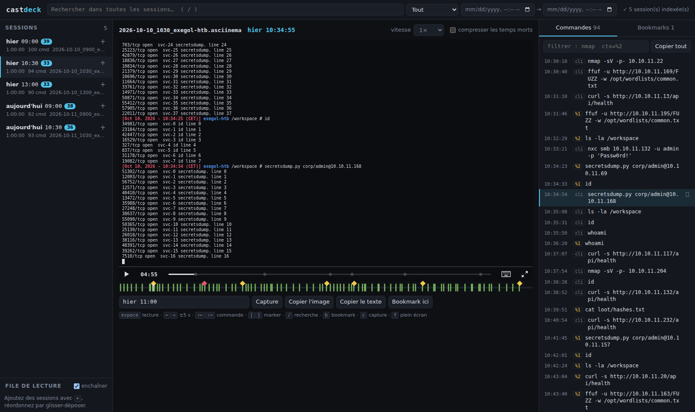

<div align="center">

# castdeck

**Revois tes sessions de pentest Exegol comme une vidéo, et retrouve n'importe quelle commande en deux secondes.**

Visionneuse locale et 100 % offline des sessions enregistrées par `exegol --log`
(asciinema `.asciinema` / `.cast`).




</div>

## Pourquoi

`exegol --log` enregistre tout, mais retrouver « le nmap d'hier vers 11 h » dans
dix fichiers `.asciinema` d'une heure est pénible. castdeck indexe toutes les
sessions et les ouvre dans une seule interface :

- **Playlist multi-sessions** triée chronologiquement, avec file de lecture réordonnable et enchaînement automatique.
- **Player fidèle** au terminal Exegol (couleurs, police monospace), vitesse 0.5× à 4×, compression des temps morts.
- **Panneau des commandes** issu de `commands.log` : clic pour sauter au bon moment, copie d'une commande ou de toutes, filtre `nmap ctx=%2`.
- **Recherche plein texte** dans toutes les sessions, sur les commandes **et** sur les sorties écran (« dans quelle session j'ai vu ce hash ? »).
- **Timeline enrichie** : une graduation par commande, les markers du cast et tes bookmarks.
- **Heure absolue** affichée en continu, et « aller à » : `hier 11:00`, `11:04`, `+5m`, `@00:12:30`.
- **Captures** : PNG de l'écran (fichier ou presse-papier) et copie du texte de l'écran.
- **Aucune requête réseau**, écoute sur `127.0.0.1` uniquement, logs ouverts en lecture seule.

## Installation

### Sur l'hôte

```bash
git clone https://github.com/ff3r0/Castdeck.git
cd Castdeck
pipx install .
```

Le front est déjà buildé dans le package : il ne faut ni Node ni accès réseau à l'exécution.

### Dans tous les conteneurs Exegol

```bash
./scripts/install-my-resources.sh
```

Le script dépose un **binaire autonome** (zipapp Python d'environ 1 Mo, `pyte` embarqué) dans
`~/.exegol/my-resources/bin/`. Il est alors dans le `PATH` de tous les conteneurs, sans rien installer.
Le binaire est aussi attaché à chaque [release](../../releases).

## Utilisation

```bash
castdeck /workspace/logs                      # http://127.0.0.1:8000
castdeck /workspace/logs --tz Europe/Paris --open
castdeck ~/.exegol/workspaces/<conteneur>/logs --port 9000 --reindex
```

Le premier lancement indexe les sessions en quelques millisecondes : l'UI est utilisable tout de suite.
Les sorties écran sont indexées en arrière-plan (progression en haut à droite). Les lancements
suivants réutilisent le cache `<dossier>/.castdeck/`.

### Données lues (jamais modifiées)

| Fichier | Rôle |
|---|---|
| `*.asciinema`, `*.cast` | sessions asciicast v2 ou v3, détectées par le header (pas par l'extension) |
| `commands.log` | `YYYY-MM-DD HH:MM:SS [ctx] commande` (heure locale), source principale des commandes |
| `panes_*.log` | texte des panes tmux : cherchable, mais sans position temporelle |

Sans `commands.log`, les commandes sont détectées en rejouant la session et en repérant le prompt
Exegol (marquées « heuristique »).

### Options

| Option | Effet |
|---|---|
| `--port N` | port d'écoute (défaut 8000) |
| `--host ADDR` | écoute ailleurs que `127.0.0.1` (avec avertissement : tes logs deviennent accessibles depuis le réseau) |
| `--reindex` | reconstruit l'index depuis zéro |
| `--tz Europe/Paris` | fuseau de `commands.log` (défaut : fuseau système) |
| `--redact` | masque `-p 'xxx'`, `password=`, les hash NTLM et les JWT |
| `--prompt-regex RE` | prompt servant à la détection heuristique (groupe 1 = la commande) |
| `--snapshot-interval S` | intervalle des snapshots d'écran indexés (défaut 5 s) |
| `--idle-limit S` | durée max d'un temps mort en mode compressé (défaut 2 s) |
| `--index-dir DIR` | emplacement de l'index (repli automatique dans `~/.cache` si le dossier est en lecture seule) |
| `--index-only` | indexe tout puis quitte |
| `--open` | ouvre le navigateur |

### Raccourcis clavier

| Touche | Action | Touche | Action |
|---|---|---|---|
| `espace` | lecture / pause | `[` / `]` | marker précédent / suivant |
| `←` / `→` | ±5 s | `/` | recherche globale |
| `⇧←` / `⇧→` | commande précédente / suivante | `b` | bookmark ici |
| `f` | plein écran | `c` | capture PNG |

### Recherche

- Elle porte sur les commandes, les sorties écran et les panes tmux. On peut la restreindre (Commandes / Sorties) et la limiter à une plage horaire.
- Elle trouve les sous-chaînes (`10.10.11` trouve toutes les IP correspondantes) et ignore la casse. Plusieurs mots = ET, `"entre guillemets"` = expression exacte.
- Un clic sur un résultat charge la session et se place une seconde avant.

## Sécurité

- Écoute sur `127.0.0.1` par défaut. Les en-têtes `Host` et `Origin` étrangers sont refusés (protection contre le DNS rebinding).
- Aucune télémétrie, aucun asset distant. La CSP n'autorise que `'self'`, plus `'wasm-unsafe-eval'` pour le module WebAssembly embarqué du player.
- Le dossier `.castdeck/` (index et bookmarks) contient **les mêmes données sensibles que tes logs**.
- `--redact` est fiable pour l'index, la recherche et les listes de commandes. Dans le flux du player, le masquage reste *best effort* : un secret tapé caractère par caractère peut y échapper.

Voir aussi [SECURITY.md](SECURITY.md).

## Limites connues

- **tmux** : l'écran enregistré est composite, donc les snapshots de sortie mélangent les panes.
- **Sortie énorme** (un `cat` d'un fichier de plusieurs Mo) : elle est tronquée dans l'index, et une mention le signale.
- **Mode compressé** : un saut qui tombe dans un temps mort atterrit à la fin de ce temps mort (±1 s).

## Architecture

```
castdeck/              backend Python : stdlib + pyte, SQLite FTS5 (tokenizer trigram)
  asciicast.py         parsing streaming v2/v3, conversion v3→v2, compression des temps morts
  commands.py          commands.log, fuseaux horaires, rattachement aux sessions
  terminal.py          rejeu pyte : snapshots texte et détection heuristique des commandes
  index.py             index et cache (mtime + taille), indexation en arrière-plan, recherche
  server.py            API JSON + front statique (http.server)
  static/              front buildé (versionné)
frontend/              Vite + TypeScript vanilla + asciinema-player
tests/                 pytest (parser, timemap, index, API)
```

**Piège `idleTimeLimit`.** asciinema-player compresse les temps morts dès que le header contient
`idle_time_limit`, et `seek()` / `getCurrentTime()` passent alors en temps compressé. castdeck
retire ce champ, compresse lui-même côté serveur et fournit une table de correspondance. Toutes les
positions restent en temps d'origine. Python et TypeScript sont testés pour produire exactement les
mêmes valeurs.

| API | Contenu |
|---|---|
| `GET /api/sessions` | liste des sessions |
| `GET /api/sessions/{id}/cast?idle=` | fichier brut (converti en v2 si v3, compressé si `idle`) |
| `GET /api/sessions/{id}/commands` | commandes de la session |
| `GET /api/sessions/{id}/timemap?idle=` | correspondance temps d'origine / temps compressé |
| `GET /api/search?q=&kind=cmd\|output\|all&session=&from=&to=` | recherche |
| `GET/PUT /api/sessions/{id}/bookmarks` | bookmarks (stockés dans `.castdeck/bookmarks.json`) |

## Développement

```bash
python3 -m venv .venv && .venv/bin/pip install -e '.[dev]'
.venv/bin/pytest                         # tests backend

cd frontend && npm ci
npm test                                 # tests front (vitest)
npm run dev                              # Vite sur :5173, proxy /api vers castdeck sur :8000
npm run build                            # -> castdeck/static/ (à committer)

./scripts/build.sh                       # binaire autonome -> dist/castdeck
```

Release : pousser un tag `vX.Y.Z`. La CI construit `dist/castdeck` et l'attache à la release GitHub.

## Licence

[MIT](LICENSE). asciinema-player (Apache-2.0) et html2canvas (MIT) sont embarqués dans le front buildé.
